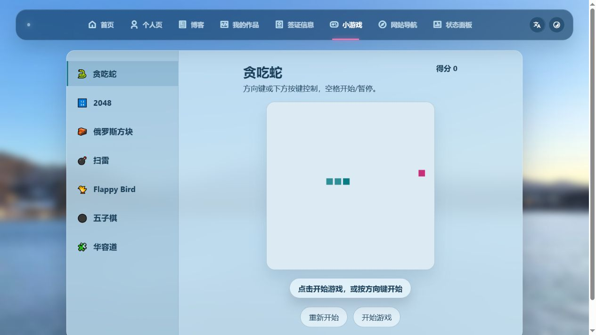
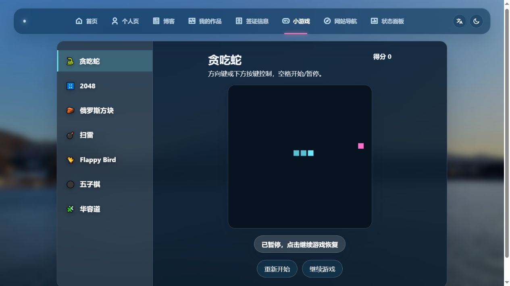
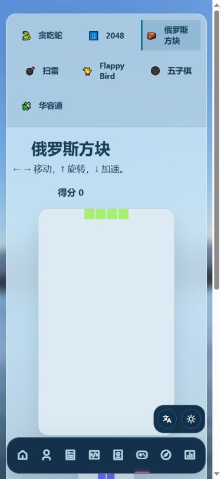
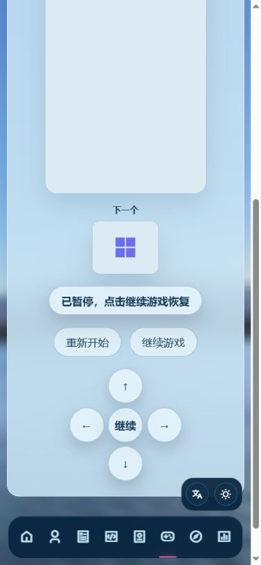
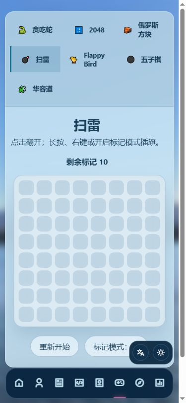
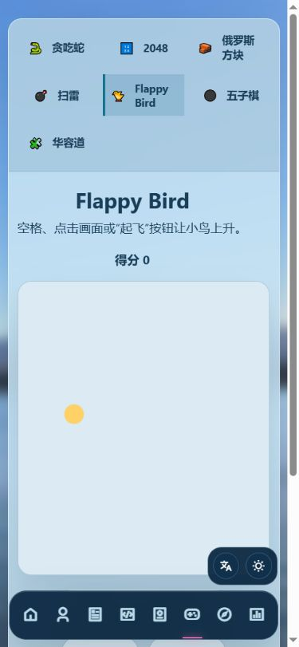
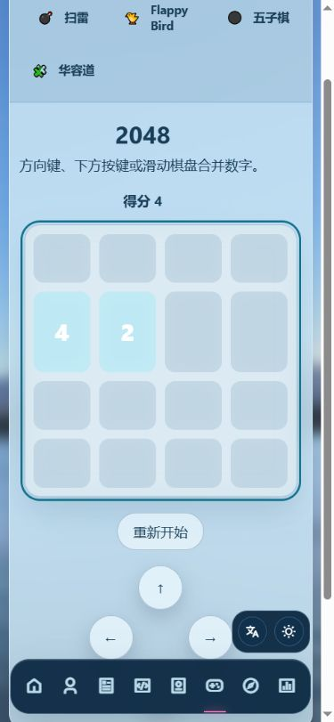
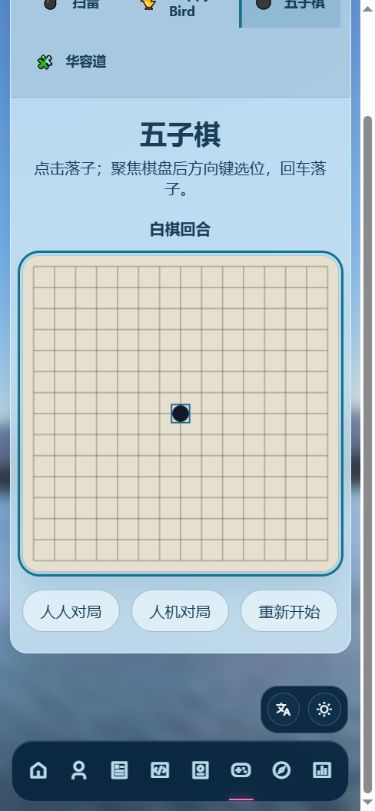
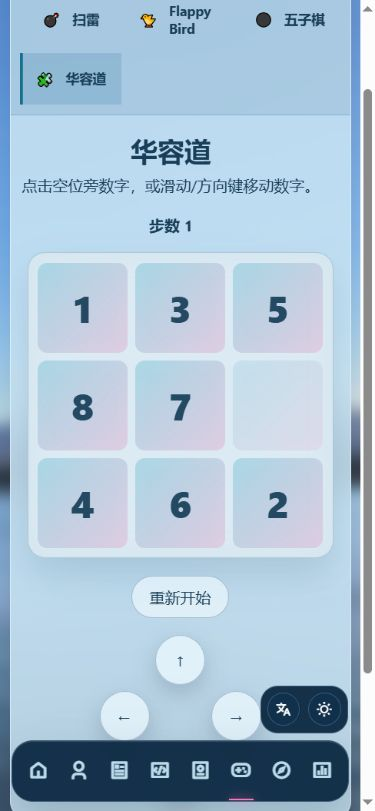

# 游戏页检查与扩展建议

日期：2026-10-17。本次只检查并记录，没有修改页面、配色或游戏实现。

## 检查步骤

1. **桌面进入、开始/暂停和日夜切换：正常。** 贪吃蛇开始后暂停，再切换夜间，继续游戏状态保留。现有两个回归脚本通过。
2. **手机视口切换和实玩：有布局与辨识问题。** 在 390×844 视口检查七种游戏入口；俄罗斯方块操作时棋盘不能完整留在屏幕内，浮动语言/主题工具与部分游戏操作区重叠，2048 日间数字对比度不足。
3. **棋盘交互、刷新与规则：基本交互正常，持久化及首步规则可改进。** 2048 左移后合并并更新得分；五子棋回车落子后切换到白棋；华容道合法移动后步数为 1，刷新后回到贪吃蛇且步数清零。扫雷首步可能踩雷由源码和独立断言确认。

## 优先处理

| 优先级 | 问题与证据 | 建议 |
| --- | --- | --- |
| 高 | 手机俄罗斯方块：预览、状态和按键均排在棋盘下方。滚到方向键并操作后，棋盘顶部 y=-112px，棋盘高约 402px，顶部已移出屏幕。见截图 03、04。 | 压缩顶部游戏选择区，预览移到棋盘旁边或顶端，并按可用高度缩放，让棋盘与方向键同时可见。避免用遮挡棋盘的浮动按键补救。 |
| 中 | 手机语言/主题浮层挡住扫雷“标记模式”按钮右侧，某些滚动位置也与方向键区重叠。扫雷状态下按钮矩形 x=177.6,y=702.8,w=133.6,h=44；工具区 x=270.8,y=713.2,w=91.6,h=49.6，存在实际重叠。见截图 05、07。 | 工具入口收进底部导航或可收起菜单；为操作区建立避让空间。相关定位在 style.css:5322。 |
| 中 | 2048 的 2/4 使用白字加半透明浅青色块，在日间浅色棋盘上辨识较弱；Flappy 的浅黄色小鸟也缺少边缘区分，俄罗斯方块使用随机浅色块。见截图 03、06、07；style.css:2361、games.js:282、567。 | 日间数字用深色；小鸟和方块增加描边或采用专门的日间色板，保留已确认的整体 UI 风格。 |
| 较低 | 扫雷在开局时直接随机放置 10 个雷，openMine 没有首步保护。第一次随机打开一格即踩雷的机会为 10/64，约 15.6%。源码位置 games.js:425、453。这是规则体验问题，不是崩溃。 | 第一次翻开后再布雷，至少保证首格安全；也可排除首格周围一圈。 |

## 可以补的耐玩功能

- 本机最高分和最佳步数；刷新后恢复 2048、华容道、五子棋等适合续玩的进度。当前没有游戏存档、最高分持久化，刷新会重新初始化全部游戏。
- 难度、计时和适当的撤销功能。它们属于新增功能，不应列为当前故障。
- 手机扫雷格子约 32×32px，触控比较精细，可考虑棋盘放大或增加误触保护。该尺寸本身不构成这里已确认的无障碍合规失败。
- 后续数量增加时，加入“益智/反应/棋类”分类，并把单个游戏拆为独立模块、按需初始化。当前在 games.js 末尾集中初始化全部七款游戏，不必为了扩展而推翻现有页面。

## 新游戏建议

| 游戏 | 适合原因 | 建议顺序 |
| --- | --- | --- |
| 记忆翻牌 | 触屏操作直接，容易提供计时、步数、难度和本机纪录 | 第一批 |
| 打砖块 | 补充现有游戏中较少的拖动/鼠标跟随玩法，可复用 Canvas 与主题能力 | 第一批 |
| 数独 | 补充较长时间的逻辑解谜，适合保存进度 | 第二批，需认真验证题目唯一解、笔记和冲突提示 |

建议先修共用的手机布局和辨识问题，再加记忆翻牌、打砖块。第一批不需要后端服务；在线排行榜或多人联机应单独规划。

## 验证与限制

- 本轮运行 `node tools/test-games.cjs` 和 `node tools/test-site-settings.cjs` 均通过。
- 对扫雷增加了一次临时断言：重新初始化后把第一个打开位置选为雷格，立即结束，确认没有首步保护；没有写入新的源码或测试文件。
- 浏览器实测覆盖开始/暂停、主题切换、入口切换、2048 键盘移动、五子棋键盘落子、华容道点击和刷新。
- 手机部分使用视口模拟和浏览器点击，未替代实体手机上的长按、滑动、多点触摸或横竖屏测试；触屏处理有现有自动回归测试支持。
- 未穷举七款游戏的所有胜负路径，也未进行长时间性能或屏幕阅读器测试，不能据此宣称完全无问题或完全符合无障碍标准。
- 已恢复自动主题并清除本次临时视口设置。

## 本轮截图

### 证据 01

桌面初始日间：入口和开始操作清楚。

### 证据 02

夜间暂停：切换后继续游戏状态保留。

### 证据 03

手机俄罗斯方块上部：棋盘和预览纵向占用较大。

### 证据 04

手机俄罗斯方块按键处：棋盘上部已滚出屏幕。

### 证据 05

扫雷：右下浮层遮住标记按钮部分区域。

### 证据 06

Flappy 日间：黄色小鸟与浅色底的边缘区分较弱。

### 证据 07

2048 左移后得分 4；浅青色块上的白色数字对比度不足。

### 证据 08

五子棋回车落子后轮到白棋。

### 证据 09

华容道一次合法移动后步数为 1。

