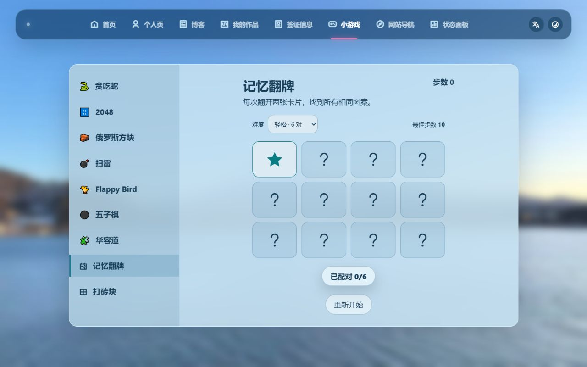
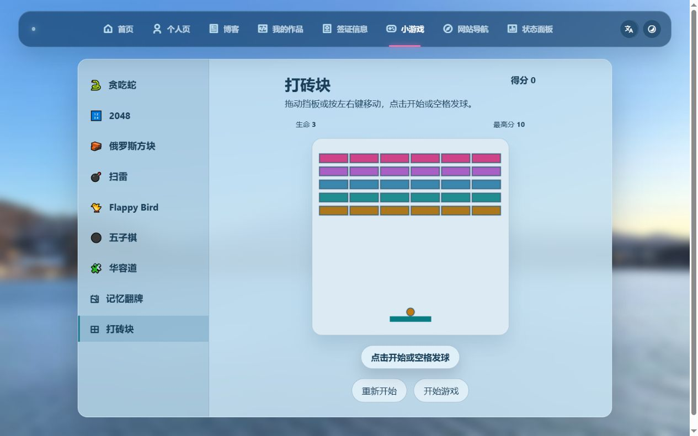

# 游戏页优化与新增验收

日期：2026-10-17。小游戏由 7 款增加到 9 款，沿用现有日夜配色、玻璃面板和四语言界面。改动限于游戏页及其资源、共用文案新增条目、文档和测试。

## 新游戏

- **记忆翻牌**：6 / 8 / 10 对三档难度；不匹配时锁定后自动盖回；匹配后不可重复点击；重开或切换会清理待执行计时器；按难度保存本机最佳步数。
- **打砖块**：30 块砖、三条生命、挡板反弹与计分；支持左右键、空格、鼠标跟随、触摸拖动和手机按键；掉球后暂停等待重新发球；胜负后停止计时器；保存本机最高分。
- 两款游戏均接入共用游戏切换、失焦暂停、页面隐藏暂停、日夜重绘和四语言翻译。存储被禁用时仍能游玩并保留本次会话纪录。

本机纪录属于当前浏览器及站点地址。此次没有增加原有七款游戏的自动存档、云端排行榜或联机功能。

## 已修复

1. 手机俄罗斯方块使用更紧凑的棋盘、侧边预览和一排方向键，实际按键后仍能完整看见棋盘。
2. 游戏页手机导航和语言/主题入口移到顶部正常文档流，取消压在游戏操作区上的悬浮工具。九款游戏在手机横向选择栏中切换。
3. 2048 日间数字使用深色，空白行与数字行固定等高；俄罗斯方块及预览增加方块边线，Flappy 和打砖块的球体增加日间颜色与边线区分。
4. 扫雷首个翻开的格子及其邻格安全，搬移地雷后重新计算邻雷数，始终保留 10 个雷。首次操作前插旗不消耗首步保护。
5. 新增资源版本号，刷新时可加载更新后的游戏资源。其他页面样式不变。

## 验证结果

| 项目 | 结果 |
| --- | --- |
| `node tools/test-games.cjs` | 通过：原有游戏回归、首步安全及雷数、共用打砖块启动/切换/隐藏暂停、主题重绘 |
| `node tools/test-extra-games.cjs` | 通过：翻牌锁定/匹配/通关/重开/难度、纪录恢复及存储失败；砖块碰撞、三条生命、重开、暂停和计时器清理 |
| 打砖块完整通关 | 自动测试通过实际输入移动挡板，清除全部 30 块砖，得分 300，胜利后无运行计时器 |
| `node tools/test-site-settings.cjs` | 通过：设置、自动模式、跨标签页、共用翻译回归及新增卡片/胜利提示翻译 |
| 浏览器记忆翻牌 | 实际翻完 6 对，用 10 步通关；刷新后最佳步数仍为 10；选择挑战难度后显示 20 张卡片且纪录独立 |
| 浏览器打砖块 | 空格发球、方向键移动与暂停正常；实际击碎砖块得 10 分，刷新后最高分仍为 10 |
| 两款新游戏四语言 | 简体、繁体、英文、日文名称、按钮及动态提示切换正常，暂停状态保留 |
| 手机 390×844 俄罗斯方块 | 实际按键后棋盘约 y=229–544，方向键底部约 y=696，均在屏幕内 |
| 手机 360×640 俄罗斯方块 | 实际按键后棋盘约 y=229–448，方向键底部约 y=599，均在屏幕内 |
| 手机 2048 | 16 格测量高度一致（约 59.1px）；日间数字为 `#173d55` |
| 浏览器扫雷 | 首次打开第 4 行第 4 列：邻雷数 0，展开 35 格，剩余标记仍为 10 |
| 短屏 640×360 | 贪吃蛇和 Flappy 画布保持至少 180px 宽，没有收缩为零；仅检查基本尺寸，未覆盖全部横屏玩法 |
| 浏览器错误、语法和空白检查 | 本轮操作未捕获到控制台 error；JavaScript 语法及 `git diff --check` 通过 |

手机验证使用浏览器视口模拟，未替代实体手机的滑动、长按、多点触摸或性能测试。触摸坐标映射、计时器与碰撞另有自动验证。检查结束后恢复简体中文、自动主题并清除临时视口设置。

## 预览

- [记忆翻牌桌面](memory-day-desktop.png) · [手机通关](memory-win-mobile.png) · [夜间挑战难度](memory-night-mobile.png)
- [打砖块桌面](breaker-day-desktop.png) · [手机日间](breaker-day-mobile.png) · [手机夜间](breaker-night-mobile.png)
- [俄罗斯方块手机修复](tetris-mobile-fixed.png) · [较小手机屏幕](tetris-small-mobile.png)
- [2048 日间辨识度及等高格子](2048-day-contrast.png)

